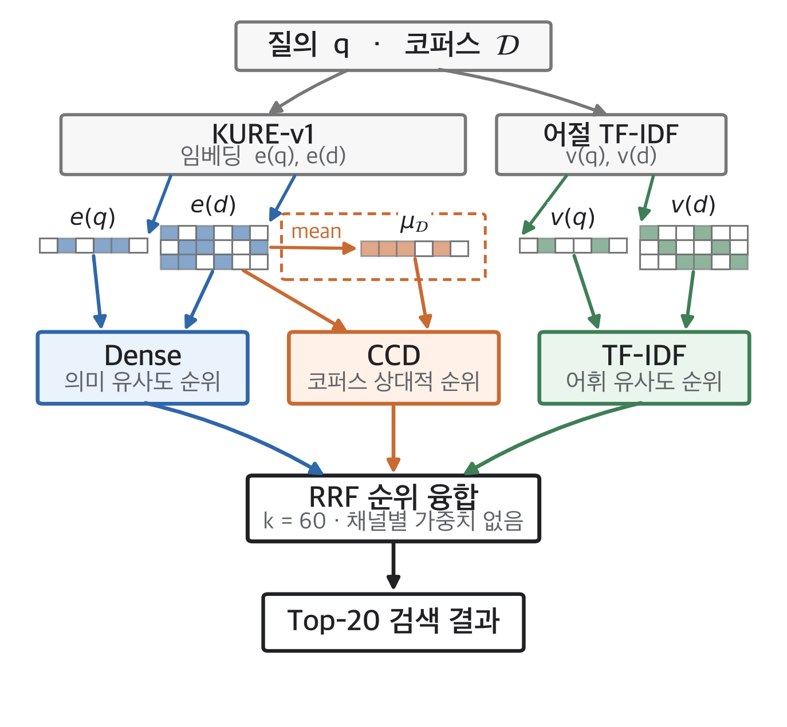

# SCL-Retrieval: Multi-Signal Rank Fusion for Similar-Case Retrieval in Emerging Voice Phishing

Code for the paper *SCL-Retrieval: 신유형 보이스피싱 유사 사례 검색을 위한 다중 신호 순위 융합 방법*
(*SCL-Retrieval: Multi-Signal Rank Fusion for Similar-Case Retrieval in Emerging Voice Phishing*), under review.

Given the transcript of a new voice phishing call, SCL-Retrieval retrieves similar past
cases from a corpus of transcripts (query-by-document). It ranks the corpus with three
signals and combines the ranks with Reciprocal Rank Fusion, without training, channel
weights or score normalisation.

| Signal | What it measures | Eq. |
|---|---|---|
| **S**emantic — Dense | cosine between KURE-v1 embeddings of query and document | (1) |
| **C**orpus-relative — Corpus-Centroid Distance (CCD) | distance of a document from the normalised corpus centroid | (2) |
| **L**exical — word TF-IDF | eojeol (word) TF-IDF cosine fitted on the corpus | (3) |

The fused score is `s_RRF(d) = Σ_c 1 / (60 + rank_c(d))` (Eq. 4).

<p align="center"></p>

## Installation

1. **Create and activate the environment**
   ```sh
   conda env create -f environment.yml
   conda activate scl
   ```
   or, without conda, `pip install -r requirements.txt` in Python 3.12.

2. **Prepare the data** — the transcripts are distributed separately. See
   [data/README.md](data/README.md) for the files and their layout, then either put them
   in `data/` or set
   ```sh
   export SCL_DATA_ROOT=/path/to/data
   ```
   Generated files go to `work/` (change with `SCL_WORK_ROOT`).

Model checkpoints are downloaded from the Hugging Face Hub on first use.

## Preprocess

* **Embeddings** — encode the 3,014 documents and 671 queries once per model
   ```sh
   # KURE-v1 only (Table 1)
   python encode.py --models kure_v1 --device cuda

   # all embedding models of Table 2
   python encode.py --models kure_v1 bge_m3 qwen3_0_6b qwen3_8b --device cuda
   ```

* **Relevance judgements (optional)** — the qrels used in the paper are in `qrels/`.
   To rebuild them by pooling BM25, mDPR and mColBERT (top 100 each, min-max averaged,
   top 10 with the query's category are relevant):
   ```sh
   python build_qrels.py --device cuda
   ```
   The script writes `work/qrels/` and reports how many queries differ from `qrels/`.
   Rebuilt on an Apple M-series GPU (MPS), the government qrels match exactly and 3 of
   224 finance queries swap one document at the pool boundary (rank 10/11), where neural
   scores are nearly tied and hardware rounding decides. Use `qrels/` to reproduce the
   paper's numbers.

## Evaluation

```sh
# Table 1 (KURE-v1)
python evaluate.py

# Tables 1 and 2
python evaluate.py --models kure_v1 bge_m3 qwen3_0_6b qwen3_8b

# with rebuilt qrels
python evaluate.py --qrels-dir work/qrels
```

Each relevant document of a query is a separate instance. Its corpus is that document
plus every document of the other impersonation domain (915 documents for finance queries,
2,101 for government queries), and Recall@20 is the fraction of instances whose relevant
document ranks in the top 20. The relevant document is placed last in the corpus, so score
ties are resolved against it. This gives 1,951 finance and 4,006 government instances.

Results (per direction and per model, for every signal combination) are written to
`work/results/{fin_gov,gov_fin}.json`, and the tables are printed.

## Results

Recall@20 reproduced with this code (KURE-v1 unless stated):

| Method | Finance queries | Government queries | Mean |
|---|---|---|---|
| Word TF-IDF | 0.771 | 0.823 | 0.797 |
| Dense | 0.697 | 0.794 | 0.746 |
| Dense + CCD | 0.798 | 0.899 | 0.849 |
| Dense + TF-IDF | 0.807 | 0.870 | 0.839 |
| **SCL-Retrieval** | **0.890** | **0.932** | **0.911** |
| SCL-Retrieval, 2:2:1 weighted z-score sum | 0.909 | 0.966 | 0.937 |

| Embedding model | Dense (mean) | SCL-Retrieval (mean) | Gain |
|---|---|---|---|
| KURE-v1 | 0.746 | 0.911 | +22.1% |
| BGE-M3 | 0.696 | 0.891 | +28.1% |
| Qwen3-Embedding-0.6B | 0.748 | 0.918 | +22.7% |
| Qwen3-Embedding-8B | 0.790 | 0.922 | +16.7% |

The RPRS baseline of Table 1 is not part of this repository.

## Repository structure

```
├── encode.py            # document/query embeddings per model
├── build_qrels.py       # BM25 + mDPR + mColBERT pooling -> qrels
├── evaluate.py          # Recall@20, Tables 1 and 2
├── qrels/               # relevance judgements used in the paper
├── scl/
│   ├── config.py        # paths, constants, model specs
│   ├── data.py          # documents, queries, qrels
│   ├── channels.py      # Dense, CCD, word TF-IDF (Sec. 3.1)
│   ├── fusion.py        # RRF (Sec. 3.2) and the weighted-sum comparison
│   ├── evaluate.py      # instances and Recall@20 (Sec. 4.1)
│   ├── encoders.py      # sentence-transformers and Qwen3-Embedding encoders
│   └── pooling/         # BM25, mDPR, mColBERT, min-max pooling
└── tests/
```

Run the unit tests with `python -m pytest tests`.
